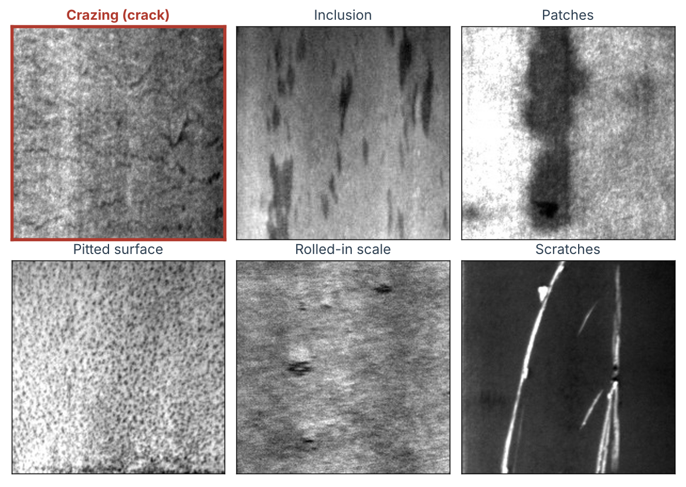
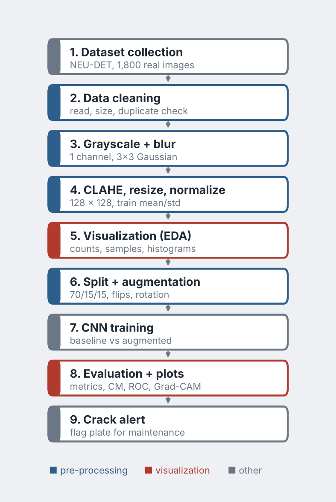
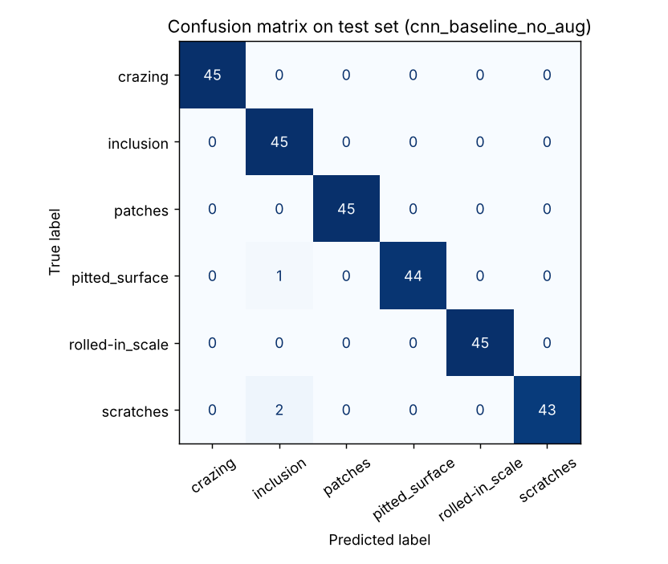
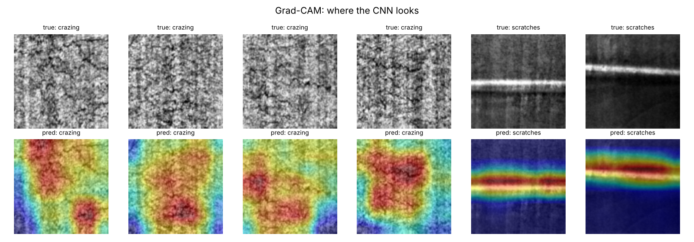

# Surface crack detection in steel plates using a CNN

AI for Engineers project (Thapar Institute of Engineering and Technology).

Problem: Tata Steel Ltd. is automating quality inspection in its manufacturing process. The task is to build a CNN-based image recognition system that finds surface cracks in steel plates from images, to support predictive maintenance and reduce defects in production.

## Dataset

NEU Surface Defect Database (NEU-DET), made by Kechen Song and Yunhui Yan at Northeastern University, China. All images are real photos of hot-rolled steel strip. No synthetic data was used.

- 1,800 grayscale images, 200 x 200 pixels
- 6 classes, 300 images each: crazing, inclusion, patches, pitted surface, rolled-in scale, scratches
- Crazing is a network of fine surface cracks, so we use it as the crack class

Source used: https://github.com/siddhartamukherjee/NEU-DET-Steel-Surface-Defect-Detection
Also on Kaggle: https://www.kaggle.com/datasets/kaustubhdikshit/neu-surface-defect-database

The dataset images are not stored in this repository. The notebook downloads them.



## Project flow



## Pre-processing

1. Cleaning: all 1,800 files readable and 200 x 200. An MD5 check found 1 duplicate (patches_101 = patches_105), which was removed. 1,799 images left.
2. Grayscale: the 3 RGB channels were identical, so 1 channel was kept.
3. Gaussian blur 3 x 3 to remove sensor noise.
4. CLAHE (clip 2.0, 8 x 8 tiles) so thin crack lines stand out.
5. Resize to 128 x 128, scale to 0-1, normalize with the training set mean (0.515) and std (0.196).
6. Stratified 70/15/15 split (seed 42): 1,259 train, 270 validation, 270 test.
7. Augmentation on the training set only: flips, 90 degree rotation, brightness and contrast changes.

## Model

Custom CNN in PyTorch, trained from scratch, about 1.18 million parameters.

| Layer group | Details | Output |
| --- | --- | --- |
| Input | 1 grayscale channel | 1 x 128 x 128 |
| Conv block 1-4 | two 3x3 convs + batch norm + ReLU + 2x2 max pool; 32, 64, 128, 256 filters | 256 x 8 x 8 |
| Global average pooling | | 256 |
| Dropout 0.4 + dense | softmax over 6 classes | 6 |

Training: Adam (lr 0.001, weight decay 0.0001), cross-entropy loss, batch 32, 20 epochs, cosine learning rate, best validation epoch kept. CPU only, about 18 minutes per model.

## Results (test set, 270 images)

| Metric | Model A: no augmentation | Model B: with augmentation |
| --- | --- | --- |
| Accuracy | 98.89% | 98.15% |
| Macro F1-score | 98.90% | 98.15% |
| ROC-AUC (macro, one vs rest) | 0.9997 | 0.9988 |
| Crack recall / precision | 100% / 100% | 100% / 100% |
| Wrong predictions | 3 | 5 |

Model A found all 45 crack images in the test set with no false crack alarms. Its 3 mistakes were 2 faint scratches and 1 pitted surface image, all predicted as inclusion.




## Files

- `steel_crack_cnn.ipynb`: full code, runs in Google Colab (downloads the data, pre-processing, plots, training, evaluation)
- `src/prep_eda.py`, `src/train_eval.py`: the same code as Python scripts
- `models/cnn_baseline_no_aug_fp16.pth`: trained weights of Model A (best model)
- `models/cnn_augmented_fp16.pth`: trained weights of Model B

The weights are stored in half precision to keep the files small. Load them with
`model.load_state_dict({k: v.float() if v.is_floating_point() else v for k, v in torch.load(path).items()})`.
The test accuracy is the same after loading (98.89% and 98.15%).
- `figures/`: all plots used in the report and slides
- `results/`: metrics (results.json), training log, data summary, train/val/test split list
- `report/ai_report.docx`: full project report

## How to run

Open `steel_crack_cnn.ipynb` in Google Colab and run all cells. Or locally:

```
pip install -r requirements.txt
git clone https://github.com/siddhartamukherjee/NEU-DET-Steel-Surface-Defect-Detection neu
mkdir allraw && cp neu/IMAGES/*.jpg neu/Validation_Images/*.jpg allraw/
python src/prep_eda.py allraw .
python src/train_eval.py NEU_steel_crack_dataset . 20
```

## References

1. K. Song and Y. Yan, A noise robust method based on completed local binary patterns for hot-rolled steel strip surface defects, Applied Surface Science, 285, 858-864, 2013.
2. R. R. Selvaraju et al., Grad-CAM: Visual explanations from deep networks via gradient-based localization, ICCV 2017.
